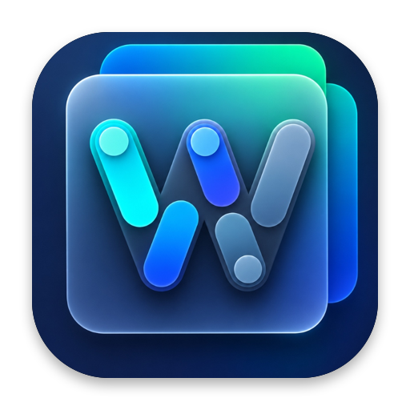

<div align="center">



# WenBar

**把 macOS 上最顺手的菜单栏时钟、农历老黄历、外接硬盘防污染与 Finder 右键压缩合而为一**

[](https://github.com/WendelYu/WenBar)
[](https://swift.org)
[](LICENSE)
[](https://github.com/WendelYu/WenBar/releases/latest)

[立即下载 DMG](https://github.com/WendelYu/WenBar/releases/latest) · [核心功能](#-核心功能) · [安装与自动更新](#-安装与自动更新) · [源码构建](#️-从源码构建)

</div>

---

## ✨ 为什么做 WenBar？

用 Mac 日常办公总会遇到几个说大不大、但天天硌应人的小痛点：

- **自带菜单栏时钟太死板**：看不到农历、节气、周数或自定义多行排版，自带日历也查不到**国务院最新放假调休**和**黄历宜忌**。
- **U 盘 / 移动硬盘拿到 Windows 满屏垃圾**：Mac 插拔一次就在盘里留下 `.DS_Store`、`._*`、`.Spotlight-V100`、`.Trashes`。
- **缺一个顺手的右键压缩/解压**：macOS 只有简单归档，遇到 Windows 发的中文 ZIP 经常文件名乱码，压缩后源目录里还留着 `.DS_Store`。

**WenBar** 用纯原生 **Swift 6 + SwiftUI + AppKit** 打造，零多余常驻后台负担，一次安装即可解决以上全部痛点。

---

## 🚀 核心功能

### 1. 高度自定义的菜单栏时钟 & 智能日历
- **12 套预设 + 所见即所得编辑器**：支持自定义格式与换行 `\n`（双行菜单栏显示），内置 **23 个占位符**（`{lunar}` 农历、`{jieqi}` 节气、`{festival}` 节日、`{holiday_cd}` 下个假期倒计时、`{weekday_cn}`、`{ampm}`、`{week}` 等），并支持保存/编辑个人模板。
- **中国农历与国务院调休**：内置 2025–2027 离线兜底数据并自动从线上同步最新放假安排，`休` / `班` 一目了然。
- **单日详情 + 传统老黄历**：点击任意日期立即显示当日农历、节气、节日、**每日宜/忌、黄道吉日/黑道日、建除十二神、冲煞、纳音、干支三柱与彭祖百忌**，支持 `«` / `»` 及下拉菜单快捷切换任意年份与月份。
- **系统日历 & 提醒事项联动（EventKit）**：直接查看、勾选完成或快速新建当日日程与提醒事项。
- **实用小工具**：内置番茄钟/倒计时（菜单栏同步显示剩余时间）、世界时钟与工作日/假期天数差计算器。

### 2. 外接硬盘 / U盘管家 & 源头防污染
- **插盘自动现身**：支持在插入外接硬盘/U盘时自动在菜单栏显示独立小图标，也可集成在主面板中使用。
- **一键清理并安全推出**：自动清理 `.DS_Store`、`._*`（AppleDouble）、`.Spotlight-V100`、`.Trashes`、`.fseventsd`、`.TemporaryItems` 后再安全推出。
- **安全护栏**：自动避让 **Time Machine 备份盘**、**系统盘** 与 **只读卷**，且清理过程严格不跟随符号链接。
- **源头防污染 + 占用排查**：支持系统级禁止向 USB/网络盘写入 `.DS_Store`、单盘写入 `.metadata_never_index`；推出被占用时自动通过 `lsof` 列出占用进程并支持强制推出。

### 3. Finder 右键菜单压缩 / 解压 & 自动清 `.DS_Store`
- **右键直达**：在 Finder 选中文件/文件夹或目录空白处右键，通过 `WenBar` 子菜单直接操作：
  - `压缩为 ZIP`（后台静默执行，不打断 Finder 操作）
  - `加密 / 自定义压缩…`（支持 `ZIP` / `7Z` / `TAR.GZ`，支持 AES-256 密码加密）
  - `解压到当前目录`（智能防散落：单根文件夹直接解出，多文件自动建同名文件夹）
  - `解压到同名文件夹`
  - `清理此目录 .DS_Store`
- **Windows 中文 ZIP 乱码自动修复**：自动识别未标记 UTF-8 的 `GB18030/GBK`、`Big5`、`Shift-JIS` 压缩包并转换头信息后无损解压，告别乱码。
- **双重干净策略**：压缩包内自动排除 `.DS_Store`、`._*`、`__MACOSX`，并在压缩完成后自动清理源目录中的 `.DS_Store`（可在设置中自由开关）。

---

## 📦 安装与自动更新

### 首次安装（拖入一次即可）
1. 前往 [**GitHub Releases**](https://github.com/WendelYu/WenBar/releases/latest) 下载最新的 `WenBar-x.x.x.dmg`。
2. 打开 DMG，将 `WenBar.app` 拖入右侧 `Applications（应用程序）` 文件夹（请务必拖入后再运行，否则无法自动更新）。
3. 首次打开若 macOS 提示“无法验证开发者”或“已损坏”，在终端运行一次以下命令（也可前往「系统设置 → 隐私与安全性」点击「仍要打开」）：

```bash
xattr -dr com.apple.quarantine "/Applications/WenBar.app"
```

4. 根据首次启动引导页启用 **Finder 扩展**（系统设置 → 登录项与扩展 → Finder 扩展 → 勾选 **WenBarFinderSync**）、日历/提醒事项与通知权限即可使用。

### 软件内自动更新（告别手动重装与隔离属性）
拖入 `/Applications` 完成初次安装后，**后续版本更新全程自动**：
- WenBar 会在启动时自动检查 GitHub Releases 最新版本（也可在「设置 → 通用」或日历面板顶部随时触发）。
- 点击 **「立即更新」 / 「下载并安装重启」**，软件会自动完成下载、签名完整性校验、清除隔离属性（无需再手敲 `xattr`）、替换升级、重新注册 Finder 扩展并自动重启。

---

## ⌨️ 快捷键与默认行为

| 操作 | 说明 |
| :--- | :--- |
| `⌥ + Space` | 全局快捷键随时唤起 / 收起日历面板（免辅助功能权限，可在设置自定义） |
| 左键点击菜单栏时间 | 打开浮动日历 / 工具 / 磁盘面板（自动留出屏幕边缘安全距离） |
| 右键点击菜单栏图标 | 打开快捷菜单（设置 / 权限引导 / 退出） |
| Finder 右键 → `WenBar` | 快速压缩 / 自定义加密压缩 / 智能解压 / 清理 `.DS_Store` |

---

<details>
<summary>🛠️ 从源码构建（面向开发者）</summary>

### 环境要求
- macOS 14.0+（已在 macOS 26 / Xcode 27.2 / Swift 6.0 验证）
- Homebrew 工具：`xcodegen`、`sevenzip`

### 本地编译与测试
```bash
git clone https://github.com/WendelYu/WenBar.git
cd WenBar

# 1. 准备内嵌 7zz 二进制与依赖
bash scripts/setup-deps.sh

# 2. 运行核心库单元测试
cd Packages/WenBarCore && swift test && cd ../..

# 3. 本地编译并自动注册 Finder 扩展
bash scripts/build-local.sh Debug
open build/Debug/WenBar.app
```

### 打包 DMG 与 Release ZIP
```bash
bash scripts/package-dmg.sh 1.0.0
```
输出位于 `dist/WenBar-1.0.0.dmg` 与 `dist/WenBar-1.0.0.zip`。

</details>

---

## 📄 开源协议与致谢

- 本项目源代码基于 [MIT License](LICENSE) 开源。
- 第三方组件与数据源说明见 [THIRD_PARTY_LICENSES.md](THIRD_PARTY_LICENSES.md)（包含 7-Zip `7zz` 与 `holiday-cn` 节假日数据源）。
